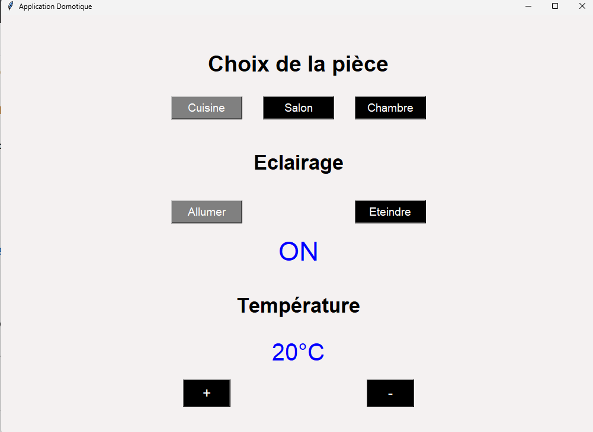
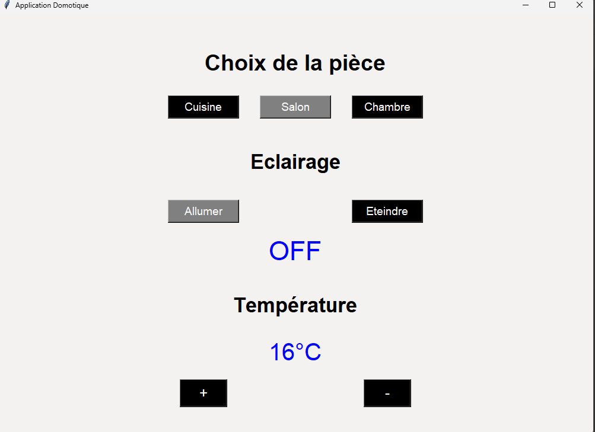

# 🏠 Simulateur de domotique

**Application de bureau Python / Tkinter — simulation du contrôle de l’éclairage et de la température dans trois pièces.**


Ce projet propose une interface graphique simple permettant de sélectionner une pièce, d’allumer ou d’éteindre sa lumière et de modifier sa température. Chaque pièce conserve **son propre état en mémoire pendant l'exécution**. L’objectif est de mettre en pratique la programmation événementielle, la gestion d’état et le développement d’interfaces avec **Tkinter**.

> **À noter :** il s’agit d’un simulateur logiciel, sans connexion à des équipements domotiques réels.

## 📸 Aperçu de l’application

<table>
  <tr>
    <td align="center" width="50%">
      <br />
      <strong>Cuisine : lumière allumée, 20 °C</strong>
    </td>
    <td align="center" width="50%">
      <br />
      <strong>Salon : lumière éteinte, 16 °C</strong>
    </td>
  </tr>
</table>

Les deux captures illustrent la conservation d’états distincts selon la pièce sélectionnée. Une [vue d’ensemble de la fenêtre](docs/screenshots/domotique-vue-ensemble.png) est également disponible.

## ✨ Fonctionnalités

| Fonctionnalité | Comportement |
| --- | --- |
| Choix de la pièce | Sélection entre **Cuisine**, **Salon** et **Chambre** |
| Éclairage | Activation ou désactivation de la lumière de la pièce sélectionnée (`ON` / `OFF`) |
| Température | Augmentation ou diminution par incréments de **1 °C** |
| Limites | Température maintenue entre **16 °C et 30 °C** |
| Affichage | Actualisation de la lumière et de la température après chaque action |
| États indépendants | Valeurs propres à chaque pièce tant que la fenêtre reste ouverte |

**État initial :** la cuisine est sélectionnée et les trois pièces démarrent avec leur lumière sur `OFF` et leur température à `20 °C`.

## 🛠️ Technologies utilisées

- **Python 3** — logique de l’application, structures de données et fonctions.
- **Tkinter** — construction de la fenêtre, boutons, libellés et variables d’interface.
- **Dictionnaires Python** — stockage des états propres à chaque pièce.

Aucune bibliothèque Python tierce n’est nécessaire.

## ▶️ Installation et exécution

**Prérequis :** Python 3 avec Tkinter, sous Windows de préférence (`fenetre.state("zoomed")` maximise la fenêtre sous Windows).

```bash
git clone https://github.com/Caze1127/Projet-Domotique.git
cd Projet-Domotique
python Domotique.py
```

Sous Windows, si `python` ne fonctionne pas, essayer `py Domotique.py`.

**Pour utiliser l’application :** sélectionner une pièce, agir sur **Allumer / Éteindre**, puis ajuster la température à l’aide des boutons **+ / −**. Changer ensuite de pièce pour consulter ses paramètres.

## 🧩 Fonctionnement technique

Le dictionnaire `etats` associe à chaque pièce un état de lumière et une température. Les interactions sont gérées par les fonctions suivantes :

| Fonction | Rôle |
| --- | --- |
| `choisir_piece()` | Met à jour la pièce active et l’interface |
| `allumer()` / `eteindre()` | Modifient la lumière de la pièce active |
| `augmenter_temperature()` / `diminuer_temperature()` | Ajustent la valeur dans les limites autorisées |
| `mettre_a_jour_affichage()` | Synchronise les textes affichés avec l’état en mémoire |

L’interface utilise notamment les widgets Tkinter `Frame`, `Button` et `Label`, ainsi que des variables `StringVar`.

## 📁 Structure du dépôt

```text
Projet-Domotique/
├── Domotique.py
├── README.md
├── .gitignore
└── docs/
    ├── Conception-Application-Domotique.pdf
    └── screenshots/
        ├── domotique-cuisine-allumee.png
        ├── domotique-salon-eteint-16c.png
        └── domotique-vue-ensemble.png
```

La [documentation de conception](docs/Conception-Application-Domotique.pdf) présente le noyau fonctionnel, les commandes, les états, les réponses perceptibles et la maquette initiale (page 5 du PDF).

## 🚧 Limites et évolutions possibles

- Les valeurs ne sont pas conservées après la fermeture de l’application.
- L’application ne contrôle pas d’objets connectés réels.
- La couleur des boutons d’éclairage n’est pas toujours resynchronisée lors d’un changement de pièce ; l’état affiché `ON` / `OFF` reste la référence.
- Évolutions possibles : sauvegarde des préférences, meilleure séparation interface / logique, adaptation à d’autres systèmes d’exploitation et tests automatisés.

---

*Projet pédagogique de développement d’interface graphique et de programmation événementielle en Python.*
